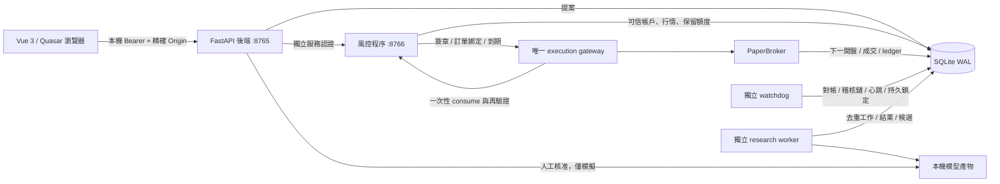
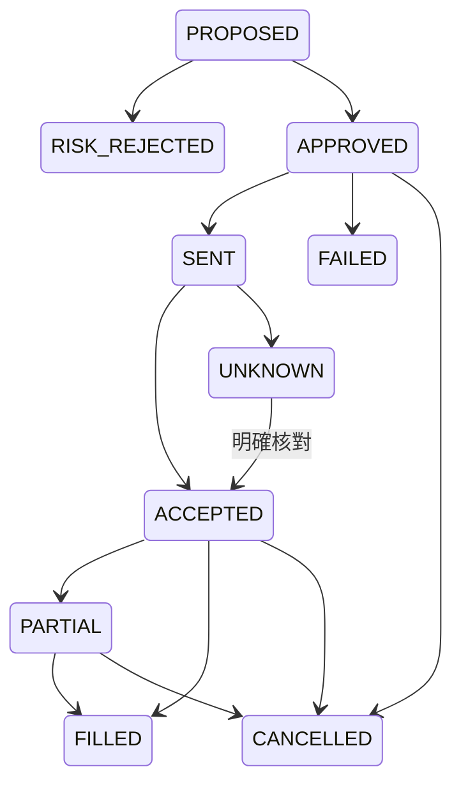

# 架構、資料流與可追溯性

同一主機上的四個 OS 程序；沒有獨立機器或對惡意管理者的防護。策略只輸出訊號／提案，唯一 `/api/orders/{id}/execute` gateway 驗證核准簽章並呼叫風控 consume 後才進 PaperBroker。前端不能傳 `approved=true` 繞過。

## 交易原子性

- SQLAlchemy connection + SQLite `BEGIN IMMEDIATE` 串行化檢查與保留額度，六張並行提案不會各自看到同一筆可用額度。
- 簽章 HMAC-SHA256 綁訂單 ID、完整 payload、規則版與有效期；使用服務端 DB，不信提案附帶資產。核准預設 30 秒，一次 consume 將狀態原子改為 SENT。
- gateway 重送使用狀態冪等；提案 Idempotency-Key 相同、內容不同回 409。成交 unique(order_id,bar)，成交、現金 ledger、持倉與保留款同一交易提交。
- 風控 HTTP timeout 不當成拒絕：若資料庫已有 SENT 但回應未知，記為 UNKNOWN；需明確核對。PaperBroker 本機持久狀態是本版核對依據，非聲稱解決外部券商不確定性。
- watchdog 心跳過期（15 秒）或風控 HTTP 不可用禁止新增風險。行情日線使用虛擬日期；核准時效與服務心跳用真實時間。
- 單筆 5%、單標的 15%、總曝險 50%、單日損失 1%、高點回撤 5%，含未成交買單保留。賣單扣除既有未成交賣單，不准超賣。拒絕損毀／缺估值帳務。可設定參數使用版本歷史與稽核。
- 部分成交按累計成交額收一次最低手續費（後續差額），買入保留額採較保守剩餘額加最低費用。賣出另收股票 0.3% 或 ETF 0.1% 稅。所有費用為模擬，不保證等於個別券商。
- watchdog 比對 ledger 現金、fills 股數、positions、orders filled、保留金額、audit hash chain，檢查服務重啟、未知狀態、拒絕激增、異常頻率及短時間重複提案；嚴重異常將 `locked` 持久化。

## 訂單狀態

## 資料表

| 表 | 用途 |
|---|---|
| settings | 模式、資金、高點、日初淨值、虛擬時鐘、持久鎖定、排程、目前模型 |
| datasets / bars | 不可變資料版本、來源／接收時間／metadata、OHLCV 與明確日期 |
| orders | 冪等鍵、不可變提案、狀態、保留款、簽章、到期、規則版本 |
| fills | 成交；order+bar 唯一 |
| positions / ledger | 持股數、平均成本、現金變動與成交關聯 |
| heartbeats | 程序實例 ID 與真實時鐘心跳 |
| alerts | 嚴重度、原因碼、事件證據、人工確認 |
| audit | append-only 應用寫入、前一 hash、目前 hash；非絕對防竄改 |
| rule_versions | 每個設定版的完整快照 |
| jobs | 持久去重 key、狀態、進度、參數快照、結果與失敗原因 |
| models | 完整實驗報告、artifact、本機人工核准記錄 |
| holdouts | 資料 hash 的最終測試集使用時間及工作 ID |

## API

啟動後 `/docs` 與 `/openapi.json` 提供 FastAPI 文件。所有 `/api/*` 讀寫都需 `Authorization: Bearer <client>`。服務 API `/authorize` 與 `/consume` 只接受不同的 service token。精確 Origin 白名單不接受任意網站；無 Origin 的 CLI 仍須 Bearer。

| 路徑 | 方法與用途 |
|---|---|
| /api/state | GET 帳戶、行情、服務、委託、告警與工作摘要 |
| /api/bars/{dataset} | GET 歷史價格 |
| /api/data/import、twse、activate | POST CSV 品質檢查、公開日線、啟用重播 |
| /api/replay/step | POST 推進虛擬時鐘並撮合 |
| /api/strategy/{symbol} | GET 規則或人工核准模型訊號 |
| /api/proposals | POST + Idempotency-Key，風控審核與保留額度 |
| /api/orders/{id}/execute、cancel、reconcile | POST 人工確認、撤單、未知狀態核對 |
| /api/control | POST pause_strategy / stop_risk / cancel_all / unlock / session_open |
| /api/alerts/{id}/ack | POST 確認告警，不解除鎖定 |
| /api/rules | POST 驗證、版本化與稽核 |
| /api/jobs、/api/jobs/{id} | POST 建立工作／GET 完整結果 |
| /api/models/{id}/approve、/api/models/reset | POST 人工模擬啟用或恢復規則 |
| /api/schedule | POST 研究排程，版本去重 |
| /api/mode | POST 永遠拒絕 LIVE/PAPER 或繞過資料集切換 |

## 研究防洩漏

特徵只用過去 OHLCV。5 日未來標籤對應 5 日 gap；每個 fold 的 imputer、scaler 與 logistic pipeline 只 fit 訓練資料。固定 seed=42、C=1，無模型搜索。最後 20% holdout 與 development 另留 gap，不以 holdout 決定候選是否可核准。全部工作與失敗都保存。新資料不足 250 筆跳過；同一資料版本不重複評估 holdout。worker 重啟將未完成 RUNNING 工作標記 FAILED，不偷偷重跑測試集。

驗證門檻為平均 balanced accuracy ≥ .52，且高於訓練多數類別基準 .01；這只是工程示例，不是勝率。模型不會自行改風控、程式或模式。排程與手動提交使用同一工作 key，防重複；訓練在獨立程序，不佔風控 HTTP 執行緒。

## 依賴與官方相容性核對

- [Quasar Vite plugin](https://quasar.dev/start/vite-plugin/)：v2 需要 Vite 8+、plugin-vue 6+、Quasar 2.24+、Node 20.19+；本專案分別鎖 8.3.6、6.0.10、2.35.2、Node 24 測試。
- [FastAPI 手動部署](https://fastapi.tiangolo.com/deployment/manually/)：Uvicorn ASGI。FastAPI 0.115.12 / Pydantic 2.11.4 / Uvicorn 0.34.2 搭 Python 3.12 實測。
- [scikit-learn TimeSeriesSplit](https://scikit-learn.org/stable/modules/generated/sklearn.model_selection.TimeSeriesSplit.html)：時間順序與 gap。採 scikit-learn 1.6.1 + NumPy 2.2.5 + SciPy 1.15.3 的已測組合，完整轉依賴鎖於 requirements.lock。

沒有把「最新版本」當成「已驗證相容」；前端 build、Python 流程及真實程序故障測試均需通過後才交付。
